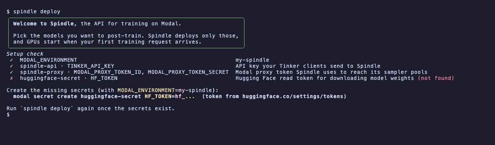
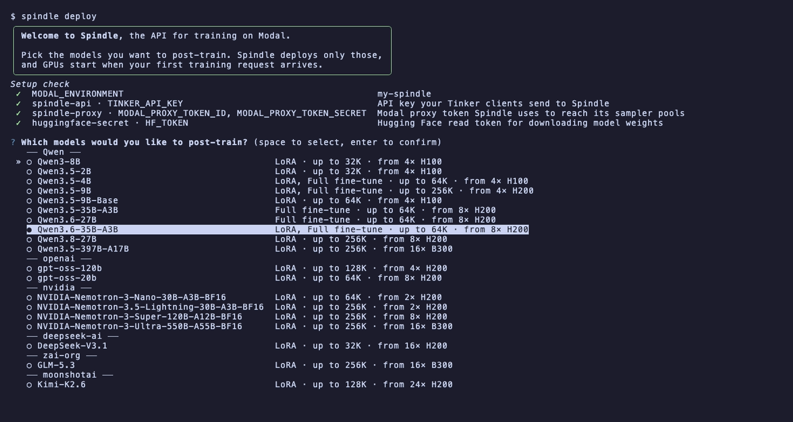
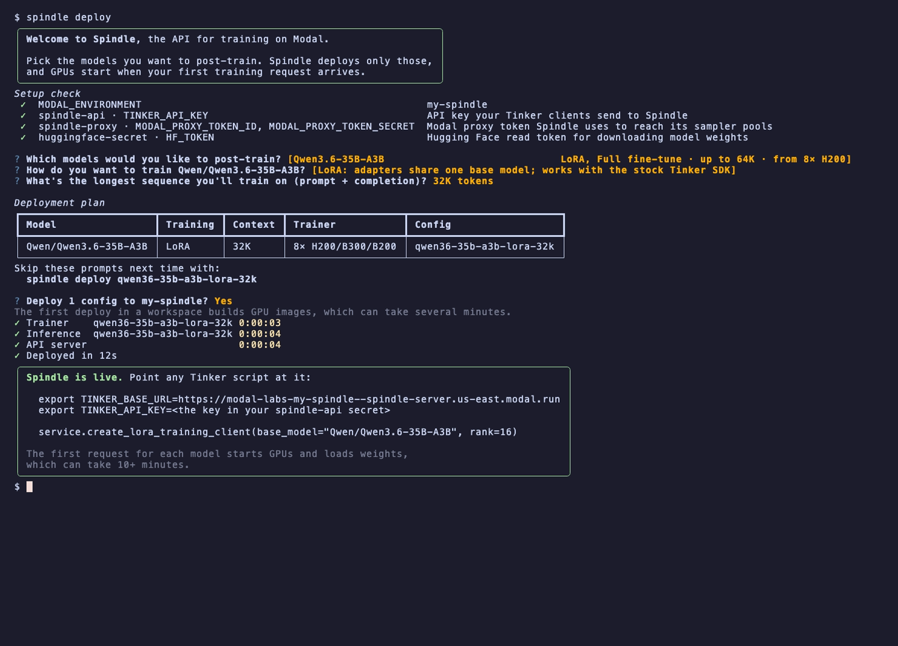

# Spindle

Spindle is an open-source Tinker-compatible API with support for
[multi-tenant LoRA training](docs/multi-lora.md) and
[single-tenant full-parameter training](docs/full-fine-tunes.md).
Trainers run `forward_backward` and `optim_step` calls, then publish updated weights to autoscaling
sampling replicas managed by the [Stitch](https://github.com/modal-projects/stitch) protocol.

## Why use Spindle?

[Owning](https://modal.com/blog/introducing-auto-endpoints) your training stack is incredibly valuable, especially if
you don't have to manage the underlying infrastructure.

Out of the box, we provide defaults that work for the vast majority of use cases. But when you need to incorporate custom forks into the backend/trainer layer,
tweak compute parameters for optimal price and performance, or even control the entire training/scheduling runtime, you have the power to do so.

Below, we detail how to setup your own Spindle server. See [here](https://modal.com/docs/examples/swe_gym) for a complete example.

## Supported training modes

- **Multi-tenant LoRA training.** Several LoRA adapters share a base model on a Miles/Megatron backend, each with its own gradients and optimizer state. This path works with the Tinker SDK out of the box via `create_lora_training_client`. See [Working with Multi-LoRA](docs/multi-lora.md).
- **Single-tenant full-parameter training (FFT).** Each run gets dedicated training containers in your Modal workspace. Tinker (v0.25) doesn't natively support FFT, so we added support ourselves using a few Spindle helpers. See [Working with Full Fine-Tunes](docs/full-fine-tunes.md) for more.

## Install Spindle

Spindle requires Python 3.12. With [uv](https://docs.astral.sh/uv/), create a project and install the library:

```bash
uv init --python 3.12 my-spindle-project
cd my-spindle-project
uv add 'modal-spindle @ git+https://github.com/modal-projects/spindle.git@v0.2.0'
```

This pins a release tag. Releases and their changes are listed in [CHANGELOG.md](CHANGELOG.md), and `uv run spindle --version` prints the installed version and commit.

**If someone has already deployed Spindle for you, skip to [Run a Tinker script](#run-a-tinker-script)** with the server URL and Spindle API key they provide. API clients don't need Modal credentials or proxy tokens.

## Set up the server

Authenticate with a [Modal account](https://modal.com/docs/guide/workspaces) that can deploy apps and create
secrets, then create and select the [environment](https://modal.com/docs/guide/environments) to deploy into
**before** creating secrets, so the secrets and the deployment end up in the same environment:

```bash
modal token new
modal environment create my-spindle
export MODAL_ENVIRONMENT=my-spindle
```

To use an existing environment, skip `modal environment create` and export its name. For automation, supply
existing `MODAL_TOKEN_ID` / `MODAL_TOKEN_SECRET` credentials instead of the interactive login.

Spindle uses four separate credentials:

| Credential | Purpose | Who needs it |
| --- | --- | --- |
| Modal API token / local profile | Manage Modal resources | Deployer |
| `TINKER_API_KEY` in the `spindle-api` secret | Authenticate calls to the Spindle API | Deployer and API clients |
| Proxy token in the `spindle-proxy` secret | Let Spindle reach protected sampler pools | Deployed control plane and trainers |
| `HF_TOKEN` in the `huggingface-secret` secret | Download base model weights from Hugging Face | Deployed trainers |

Generate an API key for your Spindle server and store it as a [Modal Secret](https://modal.com/docs/guide/secrets):

```bash
export TINKER_API_KEY="tml-$(openssl rand -hex 32)"
modal secret create spindle-api TINKER_API_KEY="$TINKER_API_KEY"
```

The Spindle server requires a [Modal Proxy Token](https://modal.com/docs/guide/webhook-proxy-auth).
Create one, export the printed `Modal-Key` and `Modal-Secret`, and allow it in your environment:

```bash
modal workspace proxy-tokens create
export MODAL_PROXY_TOKEN_ID='<Modal-Key>'
export MODAL_PROXY_TOKEN_SECRET='<Modal-Secret>'
modal workspace proxy-tokens allow "$MODAL_PROXY_TOKEN_ID" "$MODAL_ENVIRONMENT"
```

If you deploy with service-user credentials or lack permission to create workspace proxy tokens, have a
workspace owner or manager provision an allowed token and export that pair instead.

Store this token under the `spindle-proxy` secret in the same environment:

```bash
modal secret create spindle-proxy \
  MODAL_PROXY_TOKEN_ID="$MODAL_PROXY_TOKEN_ID" \
  MODAL_PROXY_TOKEN_SECRET="$MODAL_PROXY_TOKEN_SECRET"
```

Spindle downloads base weights from Hugging Face. Create a **Read** token at
[huggingface.co/settings/tokens](https://huggingface.co/settings/tokens) (for a gated model, also accept its
license on the model page with the same account) and store it under `huggingface-secret`:

```bash
modal secret create huggingface-secret HF_TOKEN=hf_...
```

### Deploy

From your project, run:

```bash
uv run spindle deploy
```

(With the project's virtual environment activated, `spindle deploy` works too.)

In a terminal, this starts an interactive deploy. It first checks that each secret above exists in
`MODAL_ENVIRONMENT` with its required keys, and prints the command to create any that are missing:



It then asks:

1. Which models to post-train. Qwen3.6-35B-A3B is selected by default.
2. LoRA or full fine-tuning, for models that support both. LoRA is selected by default.
3. The longest sequence you'll train on (prompt + completion). Each model gets its smallest bundled config that fits.



After you confirm the plan, it deploys a trainer and an inference app per config, shows progress for each, and prints
the server URL to use as `TINKER_BASE_URL`.



For scripts, CI, and agents, pass bundled config names (the interactive deploy prints the equivalent command) or
config files:

```bash
uv run spindle deploy qwen36-35b-a3b-lora-32k
uv run spindle deploy --all          # every bundled config
```

Without a terminal and without arguments, `spindle deploy` exits with this guidance instead of deploying. Bundled
configs live in [`src/spindle/configs`](src/spindle/configs). Each deploy sets the complete list of configs the
server serves, so include every config you want to keep serving.

A single deployment can serve multiple concurrent independent training jobs across different base models, training parameterizations, and experiment scales.
GPUs are allocated on demand upon the first training/inference requests, so the first step may incur longer cold start and model compilation times. See
[cold starts and capacity configuration](docs/full-fine-tunes.md#performance-and-behavior-considerations)
before running a larger workload.

### App attribution

Spindle-created Modal apps carry `_modal_source=spindle` and `spindle_role` tags
for usage reporting. Roles distinguish frontend, trainer, inference,
inference-provisioner, and combined scoped apps. `spindle_version` and
`spindle_commit` (short SHA) record the release and source commit an app was
deployed from. No environment variables are needed to set these tags.

Apps also expose reporting metadata:

| App role | `_modal_job_type` | `_modal_framework` |
| --- | --- | --- |
| Frontend | `control-plane` | omitted |
| Trainer | `training_spindle` | recipe backend (`miles` / `megatron`) |
| Inference provisioner | `serving` | omitted |
| Rollout pool / pinned sampler | `serving` | `sglang` |
| Scoped | `training_spindle` | omitted |

Model-specific apps set `_modal_model_name` to the lowercased model basename
(e.g. `Qwen/Qwen3.6-35B-A3B` becomes `qwen3.6-35b-a3b`). The frontend can serve
multiple models, so it omits that tag. `training_spindle` avoids matching the
Dojo report's source-independent `training` filter.

Add your own tags, such as a team or job ID for cost attribution, with the recipe's
`tags` field. They are applied to the recipe's trainer, inference provisioner, and
rollout pool apps:

```python
from spindle.configs.qwen36_35b_a3b_lora_32k import Config as Base


class Config(Base):
    name = "sft-job-123"
    tags = {"team": "ranking", "job_id": "job-123"}
    overrides = {"platform.frontend": "spindle-job-123"}
```

To attribute each job separately, give each job its own recipe `name`, `tags`,
and frontend, as above, so it gets its own trainer and inference apps.
`spindle deploy` publishes a frontend with exactly the recipes passed to it.
The frontend can serve several recipes, so it does not carry recipe tags.
Keys starting with `_modal_` or `spindle_` are reserved. Changing `tags`
redeploys the recipe's apps on the next `spindle deploy`. For scoped runs, pass
`spindle.run(..., tags={...})`.

Read the tags of a deployed app with the Modal SDK:

```python
import modal

app = modal.App.lookup("spindle", environment_name="your-environment")
print(app.get_tags())
```

To discover deployed Spindle apps in an environment with Modal 1.5, list apps and
filter their tags (the app-list API does not offer a tag filter):

```python
import json
import subprocess
import sys

import modal

environment = "your-environment"
rows = json.loads(subprocess.check_output([
    sys.executable, "-m", "modal", "app", "list", "--env", environment, "--json",
], text=True))
for row in rows:
    if row["state"] == "deployed":
        app = modal.App.lookup(row["description"], environment_name=environment)
        if app.get_tags().get("_modal_source") == "spindle":
            print(app.app_id, row["description"])
```

## Run a Tinker script

Any Tinker-compatible script can be run out of the box against a Spindle server just by changing the base URL and API key.

Supported Tinker SDK versions: `>=0.24.1`. CI tests the minimum version, the version
the server images pin, and the latest release. Deploy the current Spindle server before
upgrading clients: SDK 0.25 requires protobuf training and sampling responses, and SDK
0.26 requires per-sequence ids on sampling submissions.

First, set these two variables from above:

```bash
export TINKER_BASE_URL='https://your-server-url.modal.run'
export TINKER_API_KEY='your-spindle-api-key'
```

As an example, the following script implements a single step RL update, which exercises the full generation/training/sampler publication path.

```python
import os

import tinker
from tinker import types

service = tinker.ServiceClient(
    base_url=os.environ["TINKER_BASE_URL"],
    api_key=os.environ["TINKER_API_KEY"],
)
training = service.create_lora_training_client(
    base_model="Qwen/Qwen3.5-9B-Base",
    rank=16,
)
tokenizer = training.get_tokenizer()
prompt_tokens = tokenizer.encode(
    "What is 2 + 2? Answer with only the number.",
    add_special_tokens=True,
)
prompt = types.ModelInput.from_ints(prompt_tokens)
params = types.SamplingParams(max_tokens=16, temperature=1.0)

sampling = training.save_weights_and_get_sampling_client()
response = (
    sampling.sample(
        prompt=prompt,
        num_samples=1,
        sampling_params=params,
    )
    .result(timeout=3600)
    .sequences[0]
)

answer_tokens = list(response.tokens)
logprobs = list(response.logprobs or [])
assert answer_tokens and len(logprobs) == len(answer_tokens)
answer = tokenizer.decode(answer_tokens, skip_special_tokens=True).strip()
reward = 1.0 if answer == "4" else -1.0

prompt_targets = len(prompt_tokens) - 1
datum = types.Datum(
    model_input=types.ModelInput.from_ints(prompt_tokens + answer_tokens[:-1]),
    loss_fn_inputs={
        "target_tokens": prompt_tokens[1:] + answer_tokens,
        "logprobs": [0.0] * prompt_targets + logprobs,
        "advantages": [0.0] * prompt_targets + [reward] * len(answer_tokens),
    },
)

forward = training.forward_backward([datum], loss_fn="importance_sampling")
optimizer = training.optim_step(types.AdamParams(learning_rate=1e-5))

print(f"Answer: {answer!r}, reward: {reward}")
print("Training metrics:", forward.result(timeout=3600).metrics)
print("Optimizer metrics:", optimizer.result(timeout=3600).metrics)

updated_sampling = training.save_weights_and_get_sampling_client()
updated = (
    updated_sampling.sample(
        prompt=prompt,
        num_samples=1,
        sampling_params=params,
    )
    .result(timeout=3600)
    .sequences[0]
)
print("After update:", tokenizer.decode(updated.tokens, skip_special_tokens=True))
```

## Full-parameter training

For a dedicated full-parameter fine-tuning (FFT) run, use a scoped run, which brings up a single-tenant
server for the duration of the `with` block:

```python
import spindle
import tinker
from spindle.engines import qwen3_5_4b_full_64k

engine = qwen3_5_4b_full_64k()
with spindle.run(engine=engine) as (url, api_key):
    service = tinker.ServiceClient(base_url=url, api_key=api_key)
    training = spindle.create_full_training_client(service, engine.model)
    # Train and sample through the Tinker SDK here.
```

See [scoped runs](docs/scoped-runs.md) for recovery and custom engines.

## Customize the Spindle server

Since the server is just a [Modal App](https://modal.com/docs/guide/apps), everything from the compute allocation, training backend details, and inference settings is fully customizable.

For example, this Qwen3.5-9B config demonstrates some settings you might change based on your training workload.

```python
# config.py

from spindle.configuration import BaseConfig

class Config(BaseConfig):
    model = "Qwen/Qwen3.5-9B"
    name = "qwen35-9b-lora-16k"
    max_context_length = 16_384
    backend = "miles"


    trainer_gpu = "H100"
    trainer_gpus_per_node = 4
    trainer_cpu = 16
    trainer_memory_mib = 65_536
    trainer_max_clients_per_instance = 6

    miles_cfg = {
        "model_type": "qwen3.5-9B",
        "tensor_model_parallel_size": 4,
        "max_lora_slots": 6,
        "max_lora_rank": 32,
        "default_lora_alpha": 32,
        "target_modules": [
            "linear_qkv",
            "linear_proj",
            "linear_fc1",
            "linear_fc2",
            "output_layer",
        ],
        "max_tokens_per_gpu": 16_384,
        "cli_options": {
            "recompute_granularity": "full",
            "recompute_method": "uniform",
            "recompute_num_layers": 1,
        },
    }

    inference_gpu = "H200"
    inference_min_replicas = 2
    inference_max_replicas = 8
    sglang_cfg = {
        "tp_size": 1,
        "mem_fraction_static": 0.8,
        "max_running_requests": 32,
        "max_queued_requests": 8,
        "max_loaded_loras": 64,
        "max_loras_per_batch": 8,
    }


config = Config()
```

To deploy the above config, it's just:

```bash
spindle deploy config.py
```

## Upgrade Spindle

Check your current version with `uv run spindle --version`. Installs older than 0.2.0 don't have that flag; `uv pip freeze | grep modal-spindle` shows the commit they were installed from.

Read the [CHANGELOG.md](CHANGELOG.md) sections between your version and the new one; minor releases can change config defaults. Then point the dependency at the new tag and redeploy:

```bash
uv add 'modal-spindle @ git+https://github.com/modal-projects/spindle.git@v0.3.0'
spindle deploy config.py
```

To check which release a deployment runs, read the `spindle_version` and `spindle_commit` tags on its apps (see [App attribution](#app-attribution)), or call `/api/v1/get_server_capabilities`, which reports the version and full commit SHA.

## Clean up

After a training script exits, session heartbeats stop and Spindle's periodic cleaner reclaims idle training
models and their latest sampler pools. Check that cleanup has finished in the Modal dashboard or with:

```bash
modal app list
```

To tear down the deployment, stop its `spindle-fft-...` sampler apps first, then the frontend app (`spindle`
by default, or whatever you passed to `--app`) with `modal app stop <app-id>`. Stopping the frontend does not
stop sampler apps.

## Next steps

Refer to the docs for design and for more advanced features when working with either the full-parameter or LoRA paths: 

Read [Working with Full Fine-Tunes](docs/full-fine-tunes.md) for full training,
or [Working with Multi-LoRA](docs/multi-lora.md) for shared Miles adapters, batch
submission, scheduling, and sampling. See [scoped runs](docs/scoped-runs.md) for
recovery and custom engines on the full-parameter path.

See the [raw Tinker RL example](scripts/rl_example.py) for sampling and a toy
policy update. Copy examples you want to run into your project; repository
`scripts/` are not installed with the package.

The [W&B RL example](scripts/wandb_rl_example.py) extends it to a multi-step
loop that logs reward, response length, and Spindle's training metrics to Weights
& Biases from the client side; tinker-cookbook users can instead set
`wandb_project`/`wandb_name` on the cookbook `Config`.

See [Design](docs/design.md) for the control-plane, training-engine, and sampling
architecture.

See [Profiling](docs/profiling.md) for how to enable the `torch.profiler` trace of
a training step and read it in Perfetto.

See [Observability](docs/observability.md) for OTLP export to Datadog or a custom
destination, experiment labels, and the complete span/metric inventory.

## Validation

See [FFT validation](docs/validation.md) and [LoRA validation](docs/lora_validation.md)
for end-to-end training runs we've done with both parameterizations. The [Codeforces codegolf](examples/codeforces-codegolf/README.md) example provides a larger-scale e2e code-RL training run, which trains Qwen3.5-9B
with GRPO or TailRL advantages for correctness and short solutions. It includes
a sandboxed judge, checkpoint recovery, and commands to continue a checkpoint
with a different reward or advantage estimator, as well as pass@k and best-of-k evaluation. 

## Development

Install git hooks:

```bash
uvx pre-commit install
```
