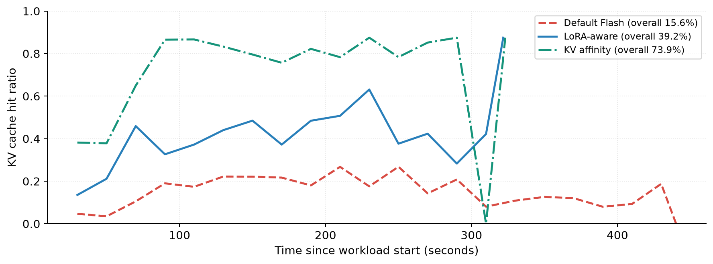
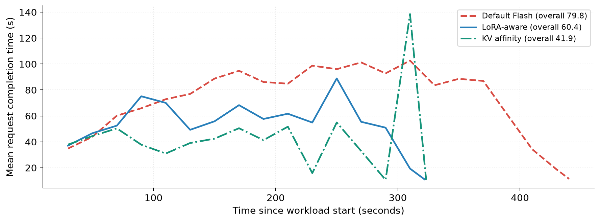
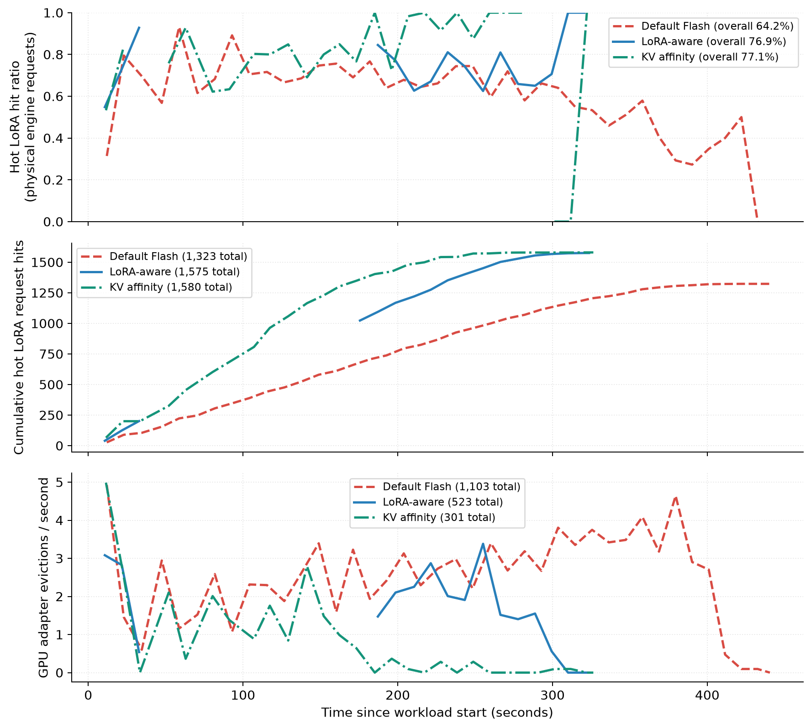
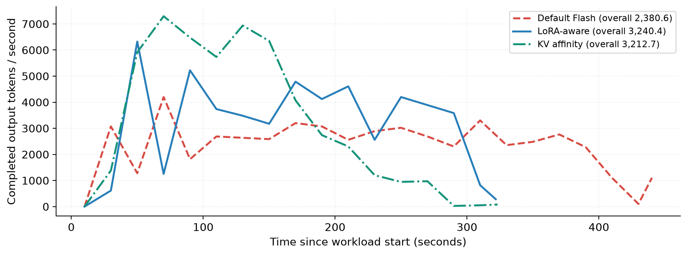
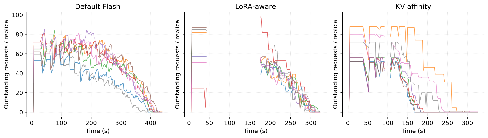
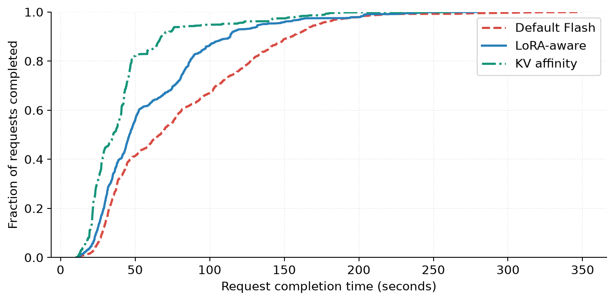

# Long-prefix LoRA and KV routing benchmark

[Full Notion report](https://app.notion.com/p/3f71e7f1694981628893fea0f75f2711?pvs=204), including full configuration, metric definitions, source hashes, and downloadable result tables/plots. The full raw-data archive remains local because automatic approval review blocked its upload to Notion. [Reproduction instructions](../scripts/benchmarks/lora_routing/CACHE_BENCHMARK.md).

**LoRA-aware routing improves the naive baseline, but stable KV affinity preserves long prefixes much better.** On the primary fixed-work comparison, both cache-aware paths deliver about 3,200 output tokens/s versus 2,381 for default. KV affinity cuts mean request latency further: 41.87s versus 60.36s for LoRA-aware and 79.83s for default. The complete workload takes 326.38s with KV and 323.60s with LoRA-aware; the nearly equal throughput hides a substantial difference in the bulk of requests and in the drain.

Compared with default, LoRA-aware routing increases throughput **36.11%**, reduces mean latency **24.39%**, and cuts GPU evictions **52.58%** (1,103 → 523). KV affinity increases throughput **34.95%**, reduces mean latency **47.54%**, and cuts evictions **72.71%** (1,103 → 301). These totals include retry costs.

**The distinguishing pattern is prefix stability and adapter churn.** Default, LoRA-aware, and KV affinity reuse 15.62%, 39.17%, and 73.85% of prompt tokens. A prefix group visits 7.05, 4.66, and 1.02 replicas on average. KV and LoRA-aware have almost identical first-prefill hot-LoRA hit ratios (77.07% versus 76.87%), yet KV needs 309 GPU loads versus 531. A request-level hit ratio alone therefore misses substantial differences in loads over the full request lifetime.

The existing LoRA heuristic is useful against the adapter-independent baseline. This workload does **not** establish it as preferable to simple KV affinity: KV has 30.62% lower mean latency and 42.45% fewer evictions than LoRA-aware. The primary full-run throughputs differ by less than 1%; read timeouts and a few remaining closed-loop clients materially affect the tail. The reversed-order repeat below checks this sensitivity. No routing-policy changes or paper policy were implemented for this experiment.

## Configuration

Same eight H200 replicas, Qwen/Qwen3.8-27B, TP=1, rank-32 LoRA, 32 immutable adapter identities (16 trained models × versions 4/7), eight GPU LoRA slots. Each policy receives 512 independent closed-loop clients and 2,048 requests. Each request has 8,192 prompt tokens (7,168 shared) and exactly 512 output tokens, with ignore_eos enabled. There are four prefix groups per adapter and four requests per stream. Engine running capacity is 36 per replica; target concurrency is 64. The request generator uses eight independent router states in one CPU function.

All adapters are CPU-registered before timing; GPU residency and KV caches are reset identically. This is frozen-weight synthetic inference, not training throughput. The existing router is unchanged. The paper policy is not implemented.

## Primary comparison

| Primary result | Default Flash | LoRA-aware | KV affinity |
| --- | --- | --- | --- |
| Output tokens/s | 2,380.62 | 3,240.36 | 3,212.75 |
| Mean latency (s) | 79.83 | 60.36 | 41.87 |
| p95 latency (s) | 172.73 | 134.97 | 108.23 |
| p99 latency (s) | 216.75 | 204.58 | 177.17 |
| KV hit ratio | 15.62% | 39.17% | 73.85% |
| Hot-LoRA hits | 1,323 | 1,575 | 1,580 |
| Hot-LoRA hit ratio | 64.16% | 76.87% | 77.07% |
| GPU loads | 1,111 | 531 | 309 |
| GPU evictions | 1,103 | 523 | 301 |
| Load-call host seconds | 88.48 | 39.59 | 22.66 |
| Retries | 16 | 1 | 2 |
| Extra engine admissions | 14 | 1 | 2 |
| Replicas/prefix group | 7.05 | 4.66 | 1.02 |

## Repeat

The full trace was repeated in order KV → LoRA.

| Reverse-order repeat | LoRA-aware | KV affinity |
| --- | --- | --- |
| Output tokens/s | 2,923.21 | 3,627.16 |
| Mean latency (s) | 59.61 | 40.87 |
| p95 latency (s) | 117.73 | 109.32 |
| p99 latency (s) | 148.11 | 182.23 |
| KV hit ratio | 40.77% | 73.92% |
| Hot-LoRA hits | 1,594 | 1,638 |
| Hot-LoRA hit ratio | 77.60% | 79.90% |
| GPU loads | 497 | 291 |
| GPU evictions | 489 | 283 |
| Load-call host seconds | 36.83 | 21.79 |
| Retries | 6 | 2 |
| Extra engine admissions | 6 | 2 |
| Replicas/prefix group | 4.27 | 1.02 |

The repeated comparison preserves the cache/mean-latency pattern: KV affinity has **31.45% lower mean latency** and **42.13% fewer GPU evictions** than LoRA-aware. KV reuse stays at 73.92%, versus 40.77% for LoRA-aware. Full-run throughput now favors KV by **24.08%**, whereas the primary run was effectively tied. This supports the cache and mean-latency result, but shows that the full-workload throughput difference is sensitive to the drain and retries.

Tail percentiles are not uniformly better: in the repeat, KV p99 is **182.23s versus 148.11s** for LoRA-aware, although KV has the lower mean, median, and p95. The repeated observed load CV is 0.281 for KV versus 0.214 for LoRA-aware; observation coverage is 99.16% versus 92.69%. Neither policy should be called universally superior or autoscaling-safe from this experiment.

## Measurement limits

Hot-LoRA ratios use physical engine admissions, including duplicate work from retries. GPU loads and evictions come from native memory-pool transitions; CPU registration is a separate counter and stays zero during measurement. Load-call timing is summed host elapsed time without CUDA synchronization, not device-copy time or critical-path savings.

The primary LoRA observer missed a 132.91-second interval, giving only 62.02% coverage by snapshots at most ten seconds old. Time-series gaps are shown explicitly; aggregate counters and complete request records remain valid. Do not rank load balance from the primary CV alone. All five completed arms validate identical traces and the same eight replicas; 10,240 requests pass exact length/version and finite-logprob checks. This does not establish bitwise output equivalence, training performance, or autoscaling behavior. An incomplete first baseline and the short pilot are excluded and documented in the archive.

## Primary-run plots

Token-weighted KV reuse by 20-second completion cohort.

Mean latency by completion cohort.

Physical hot-LoRA hits and GPU evictions; missing telemetry is not interpolated.

Completed output tokens/s; full-run throughput includes the drain.

Outstanding requests with a shared vertical scale; dotted line is target concurrency 64.

Complete request latency distribution.
