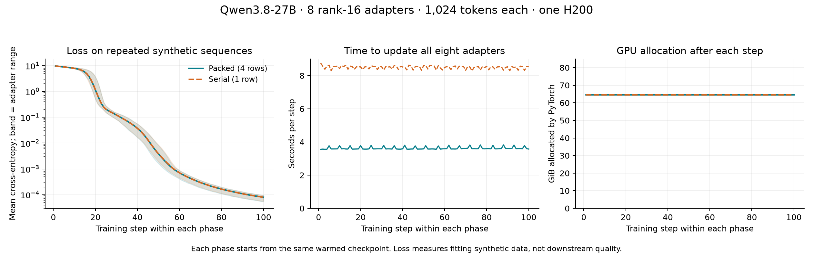

# Experimental TorchTitan multi-LoRA backend

This backend runs a native TorchTitan Qwen decoder with a shared frozen BF16
base and independently optimized LoRA adapters. H200 checks cover Qwen3.5-4B and
Qwen3.8-27B; measured configurations and numerical limits are recorded below.
The integration remains experimental: SGLang sampler parity and asynchronous SDK
throughput have not been validated.

The runtime pins TorchTitan to
[`58350410517dd62a15026e6816be874d0d5cb548`](https://github.com/pytorch/torchtitan/tree/58350410517dd62a15026e6816be874d0d5cb548)
and PyTorch to `2.16.0.dev20261023` (CUDA 13.0). Stable PyTorch 2.14.1 cannot
import this TorchTitan revision because it lacks a pipeline-liveness API.
The H200 image also pins the official PyTorch `flash-attn-3==3.0.0` wheel.

## Recipe

Use `src/spindle/configs/qwen38_27b_torchtitan_lora_16k.py` as the initial recipe.
Ordinary `BaseConfig` fields select `backend = "torchtitan"`; backend options
live in `torchtitan_cfg` and support the existing dotted recipe overrides.

The initial implementation supports **one GPU per trainer instance**. Multiple
instances can be deployed using existing Spindle placement. Tensor, context,
pipeline, and fully sharded training within a trainer are not implemented.
The 27B recipe requests one H200 and admits up to eight resident adapters, with
at most four rows per microbatch. Its 16,384-token budget can require processing
long sequences individually. The results below identify the tested client counts,
ranks, and sequence lengths.

Supported architectures are dense Qwen3.5 (0.8B, 2B, 4B, 9B, 27B) and Qwen3.8-27B,
using text inputs and unquantized HF safetensors. The loader checks architecture
settings, streams weights, excludes the vision tower, and checks that every
native parameter was loaded. MTP weights are not used. The public 4B and 27B
model configs have been checked against the native architectures.

## Adapter execution and persistence

The existing Spindle engine continues to select compatible ready requests and
serialize conflicting operations. This backend introduces no cross-client step
barrier. Each accepted model has its own seed, FP32 LoRA parameters, gradients,
AdamW state, and update counter. Forward-only requests leave gradients unchanged;
training accumulates gradients until that client's optimizer step.
Base projections and low-rank matrix multiplications use BF16. Singleton LoRA
calls retain CUDA's batched GEMM dispatch using an unused second row, avoiding
the batch-size-one reduction switch and its amplified rounding differences.

Each microbatch pads sequences to a common length and supplies document boundaries
to both full attention and Gated DeltaNet. The base projection runs once for the
combined batch, while batched matrix multiplications apply the selected adapters.
Adapter weights are gathered per sequence, avoiding a copy per token. The fused
MLP retains its base gate/up projection and has independent adapter matrices for
each branch. It exports those branches as ordinary PEFT `gate_proj` and `up_proj`
weights. Both targets must be selected together for the fused MLP.

Gated DeltaNet uses packed convolution and recurrence kernels even for a single
sequence. The pinned upstream revision otherwise switches to separate BF16
convolution/activation operations for one sequence, introducing rounding changes
when the engine changes the number of ready clients.

Activation checkpointing is enabled by default. The frozen vocabulary projection
uses chunked, recomputed log probabilities to avoid retaining a full token-by-vocab
logit tensor. Whole-layer compilation is optional and has not been benchmarked.

Supported losses currently follow the existing Miles input adapter: cross entropy,
importance sampling, PPO, CISPO, and DRO. Router replay, restricted sampling masks,
GDN projection adapters, unembedding adapters, MoE, and multimodal inputs are not
supported. Client training flags must match the deployment's target modules;
`train_unembed=False` is required.

Training checkpoints capture detached CPU copies. Checkpoints with optimizer state
also include accumulated gradients so a save between backward and optimizer step
can resume correctly. Sampler captures contain detached PEFT weights and publish
through the existing snapshot bulletin. Checkpoint formats are specific to this
backend and cannot be loaded as Miles optimizer checkpoints.

## RL weight synchronization check

`scripts/modal_torchtitan_rl.py` exercises the real SDK rollout → importance-sampling
loss → Adam update → sampler publication path with two independent rank-16 clients
on Qwen3.8-27B. One H200 runs TorchTitan and the ordinary Spindle engine and HTTP
API; another runs the pinned SGLang image and production LoRA sidecar. The validation
uses in-memory control-plane stores and an isolated Modal Volume for snapshots.
It does not modify an existing deployment.

```bash
PYTHONPATH=src python3.12 scripts/modal_torchtitan_rl.py --output torchtitan-rl.json
```

Use Python 3.12 to match the serialized Modal Functions' images. A CPU-only
preflight verifies Volume commit/reload from the worker's subprocess before GPU
allocation. Workers use Modal's built-in Function credentials.

The default is five updates per client, with a five-second start stagger. Each
rollout samples four short answers and receives a positive or negative reward
for choosing the client's preferred letter. This is an integration check, not
an evaluation of task quality or realistic RL throughput. Each client independently
publishes and starts its next rollout; the runner records rollout, training,
publication, and sampling-readiness timestamps. A deliberate pause in the second
client's first step makes independent progress observable.

The frozen base stays resident in both workers. TorchTitan exports the adapter
as ordinary PEFT tensors, including separate gate/up matrices for its fused MLP.
The existing snapshot bulletin commits immutable, hashed files to the shared
Volume. The SGLang sidecar refreshes the Volume, resolves the requested version,
and stages a verified copy on local disk before calling `/load_lora_adapter` with
a version-specific name. SGLang can retain memory-mapped adapter tensors after
loading; using the Volume path directly prevented later Volume reloads in the
27B integration test. Local staging keeps those mappings off the shared Volume.
Subsequent generation requests select that name and return the served version.
Staged snapshots remain available for the sidecar's lifetime and are removed at
shutdown; local storage needs to accommodate the registered adapter versions.

The runner checks fixed-answer log probabilities in both engines before training
and after every publication. Its acceptance limits are a maximum absolute error
below 0.25 and a mean below 0.05. It also checks that the updated policy changes,
that explicitly requesting the initial version still returns its original scores,
and that the SDK receives the requested policy version. Raw results include
behavior and training log probabilities, optimizer metrics, publication manifests,
and per-client timings. Both GPU workers have hard timeouts of at most 30 minutes;
the launcher also enforces a shared deadline, terminates the workers, and deletes
its temporary Volume on exit. Retries
need to fit the overall experiment budget; they are not automatic.

## Validation

Local validation on 2026-10-23: **155 tests passed**, covering the new backend,
deployment configuration and CLI, Modal deployment setup, and engine regression
tests. Ruff and `git diff --check` also passed.
The full GitHub CPU suite subsequently passed **695 tests, with 2 skipped**;
the codegolf example and all package build/install checks also passed. CI does
not install TorchTitan; native-runtime coverage comes from the dedicated pinned
environment and the H200 runs.

Local tests cover batched/serial output and gradient parity, repeated adapter IDs,
optimizer isolation, accumulation, forward-only behavior, nonfinite gradients,
checkpoint resume, immutable captures, fused-MLP exports, native 27B construction,
and native HF weight conversion (including tied embeddings and split shards).
An integration test also submits real backend commands through the engine and
HTTP executor, then updates one adapter while another retains pending gradients.
Model construction uses meta tensors and does not allocate 27B weights.

The commands below launch isolated, single-H200 calls in Modal `lilo-deploy`.
Run them sequentially and stop to investigate a failure; neither launcher retries
a failed or OOM run automatically.

From the worktree root, using an environment with the repository dependencies:

```bash
PYTHONPATH=src modal run --env lilo-deploy scripts/probe_torchtitan.py
PYTHONPATH=src modal run --env lilo-deploy scripts/modal_torchtitan_benchmark.py \
  --model Qwen/Qwen3.5-4B --flavor 4B --max-batch-rows 8 --output torchtitan-4b.json
PYTHONPATH=src modal run --env lilo-deploy scripts/modal_torchtitan_benchmark.py \
  --model Qwen/Qwen3.8-27B --flavor 27B --output torchtitan-27b.json
```

The probe has a 20-minute GPU timeout; model benchmarks default to 20 minutes.
`--timeout-seconds` can extend a benchmark to at most 2,700 seconds (45 minutes).
These are per-call limits; an experiment budget also needs to cover
retries and additional configurations. Each call releases its GPU on completion.
The benchmark downloads public model weights into its ephemeral container; it
does not modify an existing model-assets volume or shared deployment.

Default benchmark settings: sequence length 1024; 1, 2, 4, and 8 adapters; rank 16;
at most four rows per microbatch (the 4B command above permits eight);
two warmup steps and three measured steps per adapter count. The runner checks
packed-versus-serial log probabilities and gradients after training, detached
exports, successful updates, packed and serial training throughput, and peak CUDA
memory. Each adapter's gradient relative L2 error must be below 2.5%. These checks
run before timing. It records the exact runtime and configuration in JSON. A
failed run produces no successful benchmark report.

The 4B measurements passed the original pointwise log-probability check
(`atol=0.05, rtol=0.005`) with exactly zero observed forward difference. Native
BF16 Qwen3.8-27B varies with batch size even with every adapter disabled. Its
validation therefore measures the frozen base on the same inputs and batch shapes:
the base must have relative L2 error below 0.5% and maximum absolute error below 1.
Adapter relative L2 error may exceed the native base by at most 25% plus `1e-4`;
maximum absolute error may exceed it by at most 25% plus `0.05`. Both errors are
recorded per adapter. Independently, changing companion clients' tokens or
disabling their adapters must leave the target client's output **bitwise equal**
at a fixed batch shape. The gradient threshold is unchanged. This validates
adapter isolation while exposing the native model's numerical variability; it
does not establish bitwise invariance across batch sizes.
The [27B numerical diagnostic](benchmarks/torchtitan-h200-2026-10-23-27b-numerics.json)
records the native-base comparison, client-isolation checks, and per-layer errors.

27B is restricted to four rows per microbatch. An eight-row, 1024-token test of
the frozen native model exceeded the numerical bound (maximum log-probability
difference 1.329, relative L2 error 1.106%). Eight resident adapters can still
train through smaller microbatches; the limit is on simultaneous rows, not slots.

`--max-batch-tokens` bounds the padded tokens in each microbatch independently of
the number of clients. For example, `--sequence-length 16384 --adapter-counts 8
--max-batch-tokens 16384` admits eight adapters and processes one long sequence at
a time. `scripts/probe_torchtitan_lora.py` checks singleton/batched GEMM rounding
on representative 4B and 27B projection shapes without loading pretrained weights.

This is a **synchronized packed-backend benchmark**. It does not establish
asynchronous client throughput, rollout/publication latency, inference parity, or
an advantage over Miles. A follow-up end-to-end test must use the ordinary SDK
path with independent staggered client loops and record each client's rollout,
training, and publication timestamps separately.

## H200 results — 2026-10-23

Short synthetic cross-entropy runs on public pretrained weights, with 1,024 tokens
per adapter and rank 16 (32 allocated). Each case uses two warmup steps and three
measured steps. Timing includes forward/backward and Adam updates; model download,
loading, compilation, correctness checks, and sampler publication are excluded.
The serial baseline trains the same adapters individually on the same backend.

| Model | Resident adapters | Rows per microbatch | Step (s) | Training tokens/s | Speedup over serial | Peak allocated (GiB) |
| --- | ---: | ---: | ---: | ---: | ---: | ---: |
| Qwen3.5-4B | 1 | 1 | 0.379 | 2,700 | 1.01× | 9.00 |
| Qwen3.5-4B | 2 | 2 | 0.393 | 5,217 | 1.91× | 9.77 |
| Qwen3.5-4B | 4 | 4 | 0.552 | 7,420 | 2.76× | 11.62 |
| Qwen3.5-4B | 8 | 8 | 0.835 | 9,806 | 3.67× | 15.32 |
| Qwen3.8-27B | 1 | 1 | 1.098 | 932 | 0.92× | 53.04 |
| Qwen3.8-27B | 2 | 2 | 1.250 | 1,638 | 1.68× | 55.97 |
| Qwen3.8-27B | 4 | 4 | 1.766 | 2,320 | 2.41× | 61.82 |
| Qwen3.8-27B | 8 | 4 | 3.585 | 2,285 | 2.37× | 71.54 |

Memory reports the PyTorch allocator peak; reserved-memory peaks are in the JSON.
These short measurements are a throughput baseline, not a capacity guarantee for
every sequence-length mixture or a comparison against Miles.

The 4B forward results were identical between packed and serial execution. The
27B results were identical for 1, 4, and 8 adapters; its two-adapter case retained
native BF16 batch-size variation (maximum log-probability difference 0.153).
All 27B companion-token and companion-adapter isolation checks were bitwise equal.
Maximum gradient relative L2 errors were 1.23% for 4B and 1.39% for 27B.

Raw results: [4B](benchmarks/torchtitan-h200-2026-10-23-4b.json),
[27B](benchmarks/torchtitan-h200-2026-10-23-27b.json).

A separate Qwen3.8-27B run passed at **16,384 tokens per sequence**, with two
resident rank-16 adapters and a 16,384-token microbatch budget. It processed one
sequence at a time: **2,289 tokens/s**, **14.316 seconds** per two-adapter step,
and **72.17 GiB** peak allocated memory (74.52 GiB reserved). As expected with
one row per microbatch, speedup over serial was 1.00×. Forward outputs matched
exactly and maximum gradient relative L2 error was 0.224%. This validates the
two-adapter long-context case; eight resident adapters at 16K were not tested.

```bash
PYTHONPATH=src modal run --env lilo-deploy scripts/modal_torchtitan_benchmark.py \
  --model Qwen/Qwen3.8-27B --flavor 27B --sequence-length 16384 \
  --adapter-counts 2 --max-batch-tokens 16384 --max-batch-rows 4 \
  --output torchtitan-27b-16k.json
```

Raw result: [27B at 16K](benchmarks/torchtitan-h200-2026-10-23-27b-16k.json).

## Longer training validation

The current runner records every step's per-adapter loss and gradient norm,
duration, and allocated/reserved memory. It repeats forward isolation and gradient
checks after the packed phase and restores the same warmed parameters and Adam
state before timing the serial phase. Checkpoint I/O and correctness checks are
outside the timed regions. Progress is printed every ten steps; failed updates or
nonfinite losses stop the run, without automatic retries.

```bash
PYTHONPATH=src modal run --env lilo-deploy scripts/modal_torchtitan_benchmark.py \
  --model Qwen/Qwen3.8-27B --flavor 27B --sequence-length 1024 \
  --adapter-counts 8 --steps 100 --max-batch-rows 4 \
  --timeout-seconds 2700 --output torchtitan-27b-100-steps.json
```

This runs 100 packed steps and 100 serial steps from matching checkpoints. Each
adapter repeatedly sees its own fixed synthetic token sequence; loss reduction
measures fitting that sequence, not downstream task quality. The run retains the
synchronized packed-backend scheduling described above.

The run completed on **2026-10-23**, using benchmark code from commit
`86b0f6188aa0a01573d27a33809e7fb7e758ee45`. Both phases completed all 100 measured
steps: **819,200 tokens and 800 successful adapter updates per phase**. The GPU
container was released after the run, within its 45-minute limit.

| Schedule | Mean step (s) | Median step (s) | P95 step (s) | Training tokens/s |
| --- | ---: | ---: | ---: | ---: |
| Packed, two four-row microbatches | 3.624 | 3.586 | 3.805 | 2,260 |
| Serial, eight individual adapters | 8.500 | 8.535 | 8.626 | 964 |

The sustained speedup was **2.35×**. Peak allocated memory in the timed packed
phase was **71.54 GiB** (72.58 GiB reserved). Allocated memory sampled after each
step stayed constant throughout each phase: 64.61 GiB packed and 64.65 GiB serial.
There were no skipped updates or nonfinite losses. Mean training loss went from
9.762 to 0.00007960 packed and 0.00007969 serial on the repeated synthetic data.

After 100 packed updates, packed-versus-serial forward outputs and both companion
isolation checks remained exactly equal. Maximum gradient relative L2 error was
**1.91%**, below the unchanged 2.5% threshold. The detached sampler capture also
remained unchanged across both phases and checkpoint restoration.



Raw result with every step and adapter:
[27B, 100 steps per schedule](benchmarks/torchtitan-h200-2026-10-23-27b-100-steps.json).
